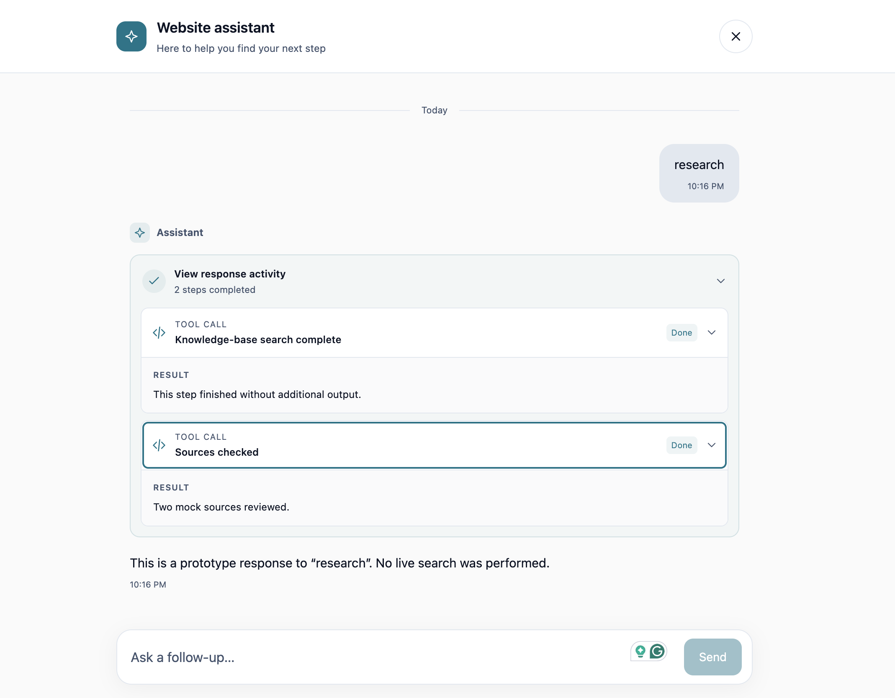
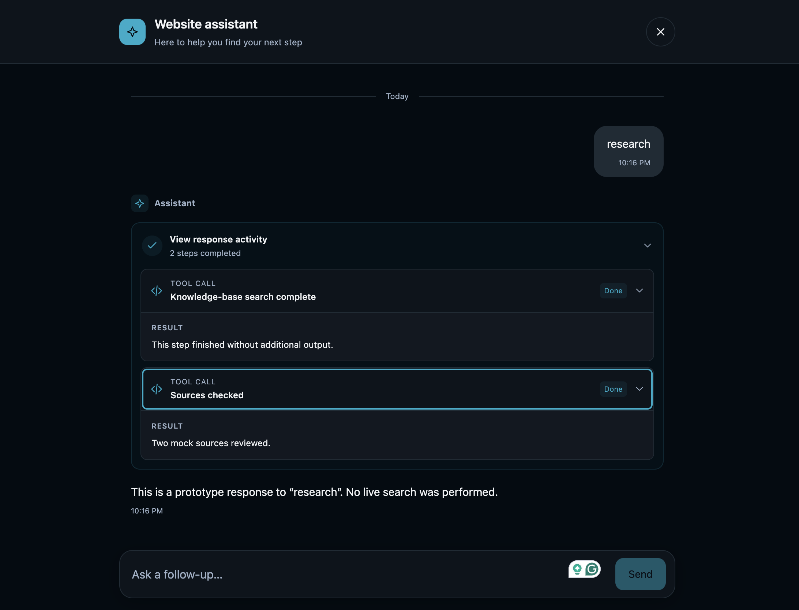

# ZAQ Web Widget

**Bring your ZAQ AI assistant to your website—without building a chat application.**

Give visitors a direct way to ask questions and get live answers, right where they
need help. A lightweight installation script adds a ready-to-use assistant, while
ZAQ handles agent routing, permissions, identity resolution, and conversation history.

## Built for your website

- **Quick to launch.** Connect your website's authenticated visitors to your ZAQ
  assistant with a backend token endpoint and a copyable installation script.
- **An engaging chat experience.** Stream answers as they arrive, show response
  progress, and let visitors return to authorized conversations.
- **Fits your design.** Choose a floating launcher or embed the assistant inside
  an existing page section. Light, dark, and automatic themes plus custom styles
  help it feel at home on your website.
- **Ready for different audiences.** Responsive layouts and English, French, and
  Arabic controls, including right-to-left layout for Arabic.
- **Keeps your website independent.** The assistant runs in an isolated iframe,
  keeping its styles and scripts separate from your site's interface.

| Light theme | Dark theme |
| --- | --- |
|  |  |

*Screenshots show the local demo with mock responses.*

## Resilient by design

Connection interruptions should not mean starting over. The widget keeps the draft
and displayed messages visible, pauses sending while disconnected, and restores
authorized conversation history after reconnecting. Authorization renews in place
without clearing drafts or ongoing response presentation.

Questions with an unknown submission outcome are not automatically resent, helping
avoid duplicate requests. On the host side, connector runtimes recover from widget
infrastructure restarts without requiring visitors to manage the recovery process.

## Security at the boundary

Your backend decides who the visitor is. Signed identity tokens bind access to the
visitor and widget; the signing key stays on your backend, never in the installation
script. Exact allowed-origin checks restrict embedding, and ZAQ authorizes access
to conversations rather than trusting a browser-supplied conversation ID.

Optional backend-verified name, email, and phone details support ZAQ's existing
People enrichment. Token expiry and backend revocation protect session access,
while widget transport sessions remain separate from the host's back-office sessions.
Deploy over HTTPS and configure the documented cookie and origin policies; browser
privacy settings can still restrict iframe access.

## Simple website integration

1. Enable a Web Widget connector in ZAQ and allow your website's origin.
2. Add an authenticated token endpoint to your website backend.
3. Paste ZAQ's generated installation script into your page.

The script mounts the widget and handles token renewal. No frontend framework
integration or custom chat UI is required.

**Follow the [website integration guide](docs/integration-guideline.md)** for the
token schema, signing example, installation, customization, and logout handling.

## Technical documentation

| Guide | What it covers |
| --- | --- |
| [Website integration](docs/integration-guideline.md) | Add the assistant to a website and issue identity tokens. |
| [Host integration](docs/host-integration.md) | Phoenix hosting, supervision, routes, assets, cookie policy, proxies, and cluster configuration. |
| [Authenticated chat](docs/authenticated-chat.md) | Authentication lifecycle, renewal, revocation, and operational smoke checks. |
| [Adapter contract](docs/adapter-contract.md) | Host/widget responsibilities, trusted profile transport, and message and response contracts. |
| [Development](docs/development.md) | Run the local demo, build assets, contribute, and run validation. |

The package uses Phoenix LiveView with React and assistant-ui for presentation.
Browser realtime traffic uses the existing LiveView WebSocket. Host integration
uses public adapter hooks without a compile-time dependency on ZAQ internals.

## Contributing

Improvements to behavior, accessibility, translations, documentation, and tests are
welcome. See the [development guide](docs/development.md) for setup and checks, and
[AGENTS.md](AGENTS.md) for repository working guidelines.
